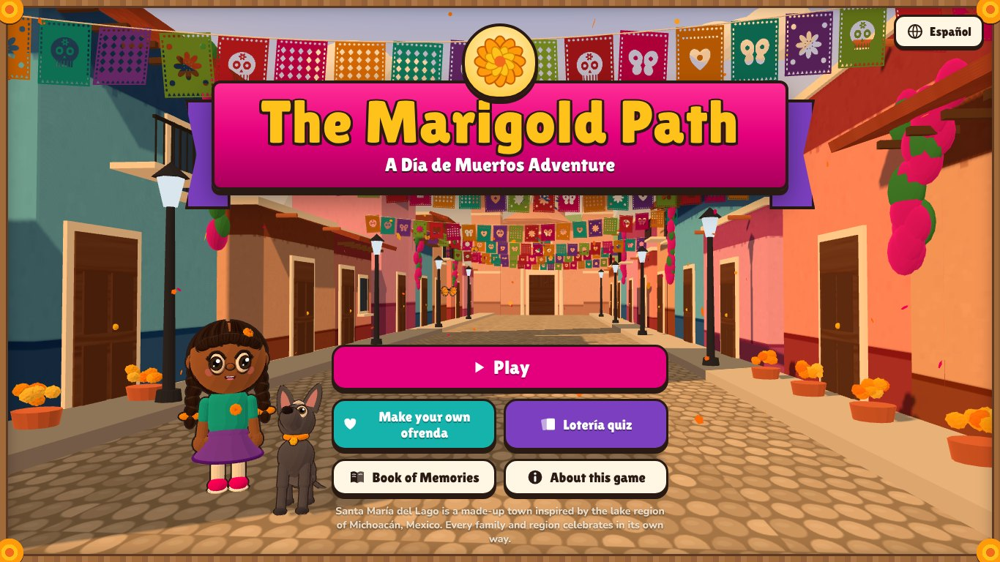
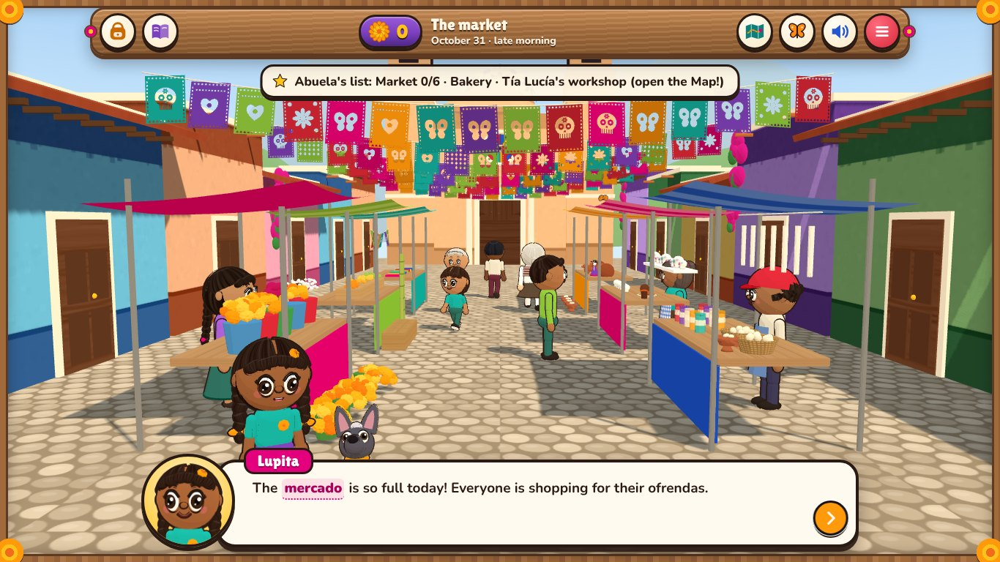
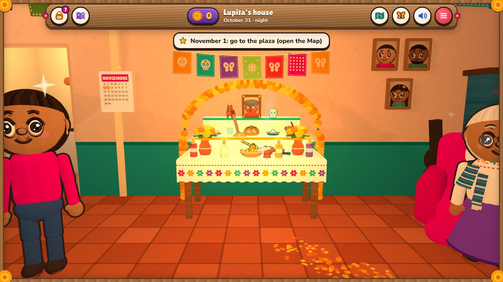
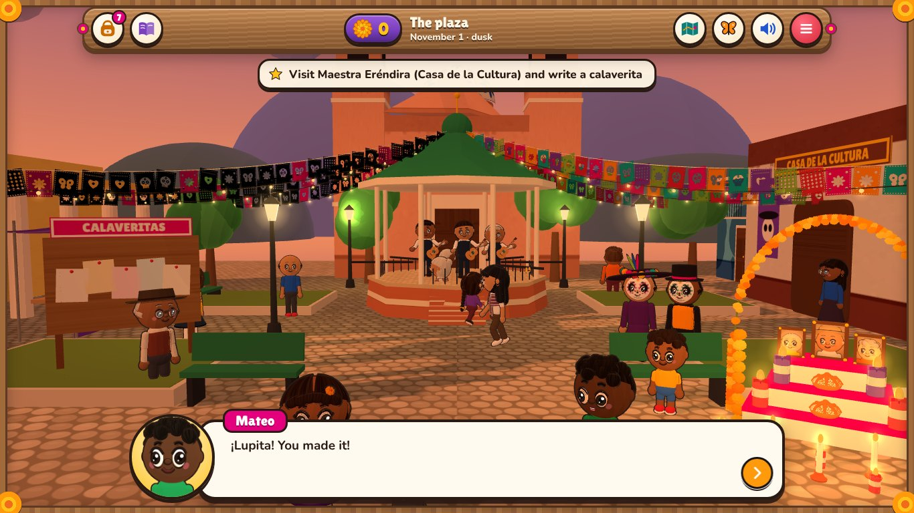
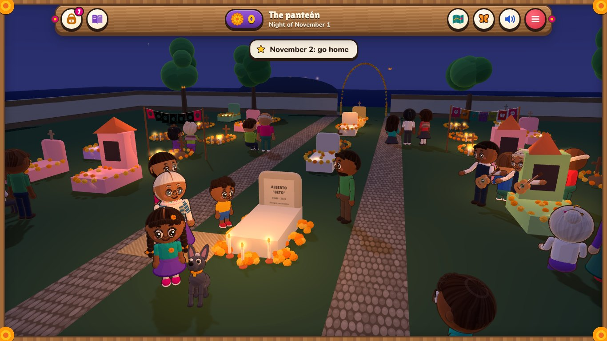

# The Marigold Path · El Camino de Cempasúchil

*An educational point-and-click adventure about Día de Muertos (Day of the Dead), in 3D, in English and Spanish.*

Help Lupita, her Xoloitzcuintle dog Chispa and her Abuela get ready to welcome Abuelo Beto home. Gather marigolds and candles at the market, bake pan de muerto, chisel papel picado, decorate a sugar skull, **build the family's ofrenda**, learn the history at the plaza, and keep the candlelit vigil at the panteón.



## How to play

| | |
| --- | --- |
| **Easiest** | Double-click **`play-offline.html`**. It's the whole game in one file — no internet, no install. |
| **Windows** | Double-click **`play.bat`** (needs Python). |
| **Mac / Linux** | `python3 serve.py`, then open the address it prints. |

Click (or tap) on people and things — anything that sparkles can be clicked. The **map** button takes you around town; the **butterfly** button shows what you can click; the **book** holds everything you've learned. Spanish words in **pink** can be tapped to hear them and see what they mean. Keyboard: **Tab** moves between clickable things, **Enter** clicks, **Space** continues dialogue, **M** opens the map, **H** shows hints.

Progress saves automatically in the browser. The **menu** (top right) has English/Español, read-aloud, bigger text, calm mode (less motion) and sound settings.

## What's inside

**The story** (about 30–45 minutes) runs from the morning of October 31 to November 2 in Santa María del Lago, a made-up town inspired by the lake region of Michoacán.

| Place | What you do | What you learn |
| --- | --- | --- |
| Lupita's house | Meet the family; explore; later, **build the ofrenda** | What the holiday is (and isn't), the dates, the Xolo and Mictlán, corundas |
| The market | Shop at six stalls | Cempasúchil, candles, copal, fruit, sugar skulls (alfeñique, Toluca), papel de China |
| The bakery | Bake pan de muerto: mix, knead, shape the "bones", bake, top | What people say the shapes mean; regional breads |
| Tía Lucía's workshop | Chisel papel picado the Huixcolotla way; paint a sugar skull | Papel picado, the "color code" myth, alebrijes (1936, not ancient) |
| The plaza | Talk to Maestra Eréndira, write a calaverita, meet the Catrinas | Posada and La Catrina, origins, UNESCO, the Purépecha vigil, an interactive map of Mexico |
| The panteón | Clean the grave, lay marigolds, light candles, keep the vigil | Cemetery traditions and good manners |

**The ofrenda builder** — choose 1, 2, 3 or 7 levels, then place the photo, flowers, candles, copal, water, salt, bread, your sugar skull, your papel picado, Abuelo's guitar and more. There's no score and no "wrong" ofrenda: Abuela's wishes are story goals, and every item explains what many families say it means. Light the candles and drag a path of petals from the door.

**Make your own ofrenda** — honor someone in your family, a pet, a hero from history, someone you admire or a story character. Draw their portrait (no photos needed), pick their favorite things (pizza counts!) and download a picture.

**Lotería quiz** — the caller reads a riddle; put a bean on the matching card. Four in a row (or the four corners) and shout ¡Lotería! Then print a certificate.

**The Book of Memories** — 11 illustrated chapters (what it is, dates, roots, the ofrenda, food, symbols & art, the cemetery, around Mexico, around the world, myths & facts, with respect), a collection of **55 Lotería-style learning cards**, a glossary of 86 words with pronunciation, and all the sources.

Twelve hidden monarch butterflies are tucked around town.

| | |
| --- | --- |
|  |  |
|  |  |

## Accuracy and respect

The content was researched from Mexican institutions (INAH, INPI, the Secretaría de Cultura and other agencies), UNESCO, museums (the Smithsonian, the National Museum of Mexican Art) and scholars, and checked against guidance from Mexican and Mexican-American educators about teaching Día de Muertos respectfully. See:

- [`docs/research-notes.md`](docs/research-notes.md) — how the research shaped the game (the design rules).
- [`docs/research-facts.md`](docs/research-facts.md) — the full fact research, with sources and confidence tags.
- [`docs/research-sensitivity.md`](docs/research-sensitivity.md) — the cultural-sensitivity research.

A few of the choices: the ofrenda is never graded; beliefs are described ("many families believe…") rather than presented as fact; the game says where historians disagree; modern additions (La Catrina, alebrijes, the Mexico City parade, pet ofrendas) are labeled as modern; no sombrero/mustache stereotypes, no Halloween imagery, no "spooky" tone; the visit of the souls is only suggested with gentle signs from the tradition; and players draw portraits instead of uploading photos.

**Honest limits:** the research was done through web searches, and some details in the "around the world" chapter are marked ⚑ as not yet checked against a source. A real studio would also hire Mexican and Mexican-American consultants and playtest with families from the community. If you share this game, showing it to people from the community and listening to their feedback is the best next step.

## Under the hood

Everything — characters, the town, the music and the sound effects — is made with code: no images, models or audio files (except two open-licensed fonts).

- **3D**: [Three.js](https://threejs.org) r160 (vendored in `vendor/`), cel-shaded "toon" materials with ink outlines, procedural characters with hand-written animation (`src/characters.js`), a town kit (`src/world.js`, `src/room.js`) and an ofrenda prop library (`src/props.js`).
- **Game**: `src/main.js` (game state, saving, panels), `src/engine.js` (renderer, camera, clickable hotspots), `src/scenes/*` (one file per place), `src/games/*` (ofrenda builder, papel picado, calaverita poem).
- **Content**: `src/content/*` — learning cards, book chapters, glossary, quiz riddles and sources, each in English and Spanish.
- **Sound**: `src/audio.js` synthesizes a plucked guitar, marimba, flute and bells in WebAudio and plays original pieces for each place.
- **Fonts**: Lilita One and Nunito, SIL Open Font License (`fonts/`).

### Development

```bash
npm install            # only needed for the build tool (esbuild)
npm run build          # rebuilds play-offline.html after you change src/
npm run smoke          # fast content + 3D builder checks (no browser)
npm run story          # plays the whole story headlessly with Playwright, saving screenshots in qa/story/
python3 serve.py       # play the development version
```

Test URLs: `index.html?scene=market&cheat=intro` jumps to a place (`cheat=` one of intro, market, pan, workshop, ofrenda, plaza, panteon, ending); `&reset` clears progress; `&fast&lowq` speeds up headless testing.

## Credits

Made with Claude Code. Fonts: *Lilita One* by Juan Montoreano and *Nunito* by The Nunito Project Authors (SIL OFL 1.1). Three.js © three.js authors (MIT).
