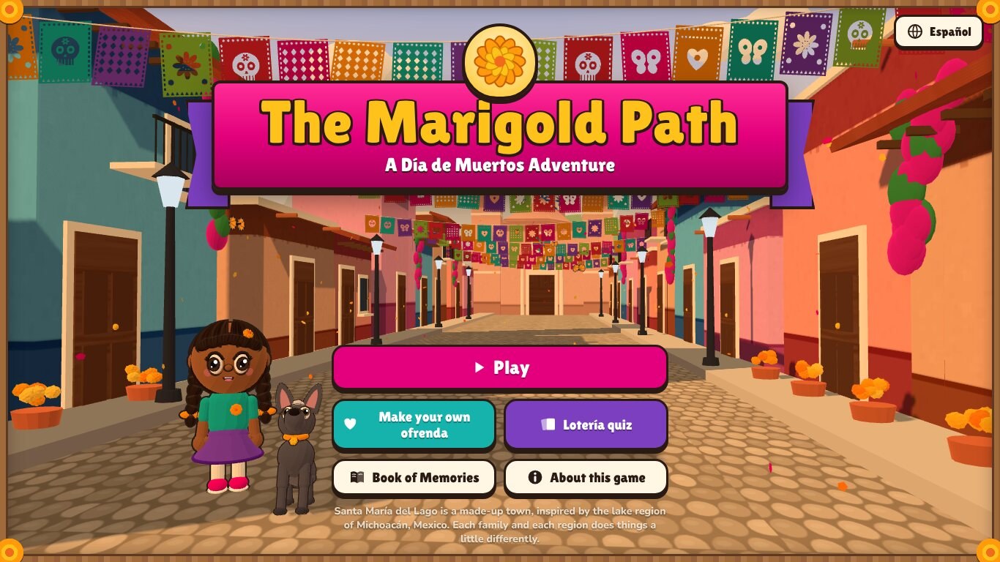
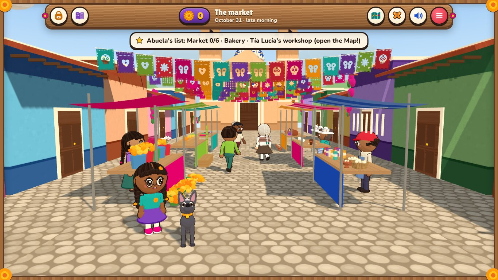
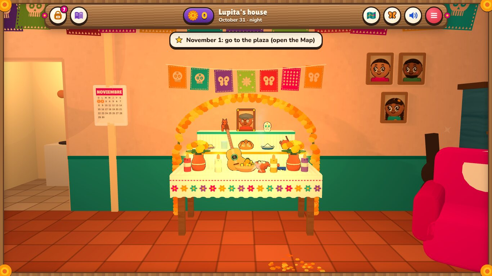
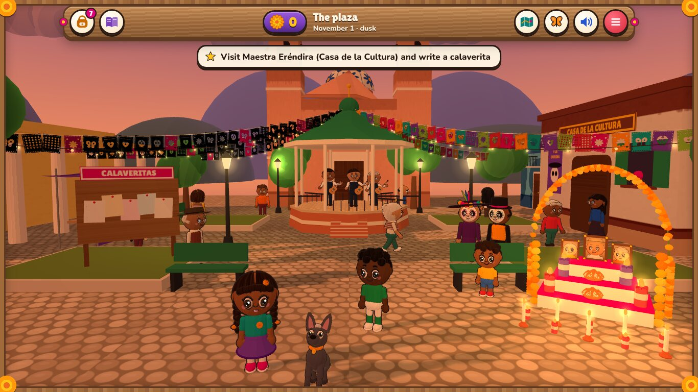
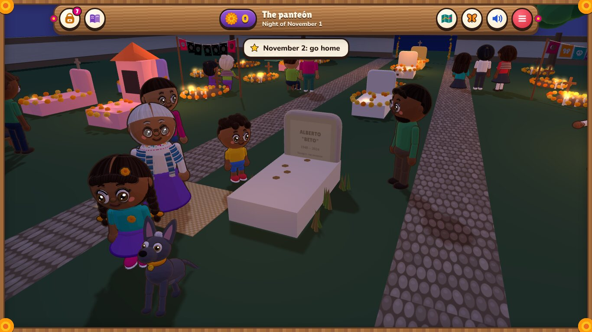

# The Marigold Path · El Camino de Cempasúchil

*A point-and-click adventure about Día de Muertos (Day of the Dead), in 3D, in English and Spanish.*

You help Lupita, her Xoloitzcuintle dog Chispa and her Abuela get ready to welcome Abuelo Beto home. You buy marigolds and candles at the market, bake pan de muerto, cut papel picado, paint a sugar skull, **build the family's ofrenda**, learn some history at the plaza, and stay up with the family at the panteón on the night of November 1.



## How to play

| | |
| --- | --- |
| **Easiest** | Double-click **`play-offline.html`**. The whole game is in that one file. No internet or install needed. |
| **Windows** | Double-click **`play.bat`** (needs Python). |
| **Mac / Linux** | Run `python3 serve.py`, then open the address it prints. |

Click (or tap) people and things. Anything that sparkles can be clicked. The **map** button takes you around town, the **butterfly** button shows what you can click and tells you what to do next, and the **book** keeps everything you've learned. Spanish words in **pink** can be tapped to hear them and see what they mean.

Keyboard: **Tab** moves between clickable things, **Enter** clicks, **Space** continues the dialogue, **Ctrl+Z** (or **⌘Z**) undoes, **Esc** closes a panel or lets go of what you're holding, **M** opens the map and **H** shows hints.

Progress saves on its own, in the browser. The **menu** (top right) has English/Español, read-aloud, bigger text, calm mode (less motion) and sound settings. Starting a new adventure keeps a copy of the old one, and the title screen can bring it back.

## What's in it

**The story** takes about 30 to 45 minutes. It runs from the morning of October 31 to November 2 in Santa María del Lago, a made-up town inspired by the lake region of Michoacán.

| Place | What you do | What you learn |
| --- | --- | --- |
| Lupita's house | Meet the family, look around, and later **build the ofrenda** | What the holiday is (and isn't), the dates, the Xolo and Mictlán, corundas |
| The market | Shop at six stalls | Cempasúchil, candles, copal, fruit, sugar skulls (alfeñique, Toluca), papel de China |
| The bakery | Bake pan de muerto: mix, knead, shape the "bones", bake, pick a topping | What people say the shapes mean, and breads from other regions |
| Tía Lucía's workshop | Cut papel picado the Huixcolotla way, paint a sugar skull | Papel picado, the "color code" myth, alebrijes (1936, not ancient) |
| The plaza | Talk to Maestra Eréndira, write a calaverita, meet the Catrinas | Posada and La Catrina, where the holiday comes from, UNESCO, the Purépecha vigil, a map of Mexico |
| The panteón | Clean the grave, lay marigolds, light candles, keep the vigil until sunrise | Cemetery traditions and manners |

**The ofrenda builder.** Pick 1, 2, 3 or 7 levels (you can change it later), then put out the photo, flowers, candles, copal, water, salt, bread, your own sugar skull and papel picado, Abuelo's guitar and more. There's no score and no "wrong" ofrenda. Abuela's wishes are just story goals, and every item tells you what many families say it means. Click anything on the ofrenda to move it or put it back, and use **Undo** or **Clear all** whenever you like. If you leave halfway, it's still there when you come back. When it's ready, light the candles and drag a path of petals from the door.

**Undo everywhere.** Every place where you make something has an Undo button (and Ctrl+Z): the ofrenda, papel picado (each stamp and each chisel tap), the sugar skull, the bread's bones, the petal path, and the portrait you draw in free mode. You can also cut new papel picado or repaint the skull later at Tía Lucía's, try other toppings on the bread, step back through the calaverita lines, and take your poem off the board.

**Make your own ofrenda.** Honor someone in your family, a pet, a hero from history, someone you admire or a character from a story. You draw their portrait (no photos needed), pick their favorite things (pizza counts!) and download a picture of it.

**Lotería quiz.** The caller reads a riddle and you put a bean on the matching card. Get four in a row, or the four corners, and shout ¡Lotería! Then you can print a certificate.

**The Book of Memories.** 11 illustrated chapters (what it is, the dates, its roots, the ofrenda, food, symbols and art, the cemetery, around Mexico, around the world, myths and facts, and how to take part respectfully), **55 Lotería-style learning cards** to collect, a glossary of 86 words with pronunciation, and every source.

There are also twelve monarch butterflies hidden around town.

| | |
| --- | --- |
|  |  |
|  |  |

## Accuracy and respect

The facts come from Mexican institutions (INAH, INPI, the Secretaría de Cultura and other agencies), UNESCO, museums (the Smithsonian, the National Museum of Mexican Art) and scholars. They were checked against advice from Mexican and Mexican-American educators about teaching Día de Muertos respectfully. More detail:

- [`docs/research-notes.md`](docs/research-notes.md): how the research shaped the game.
- [`docs/research-facts.md`](docs/research-facts.md): the fact research, with sources and how sure we are of each.
- [`docs/research-sensitivity.md`](docs/research-sensitivity.md): the cultural-sensitivity research.

Some of the choices that came out of it: the ofrenda is never graded. Beliefs are described as beliefs ("many families believe…"), not stated as fact. The game says where historians disagree. Newer additions (La Catrina, alebrijes, the Mexico City parade, ofrendas for pets) are labeled as new. There are no sombrero or mustache stereotypes, no Halloween imagery and nothing spooky. The souls' visit is only hinted at, with small signs from the tradition. And players draw portraits instead of uploading photos.

**Limits to know about:** the research was done with web searches, and a few details in the "around the world" chapter are marked ⚑ because they haven't been checked against a source yet. A real studio would also hire Mexican and Mexican-American consultants and test the game with families from the community. If you share this game, the best next step is to show it to people who celebrate Día de Muertos and listen to what they say.

## How it's made

Everything you see and hear (the characters, the town, the music and the sound effects) is made with code. There are no image, model or audio files, except two open-licensed fonts.

- **3D**: [Three.js](https://threejs.org) r160 (in `vendor/`), cel-shaded "toon" materials with ink outlines, hand-animated characters built from shapes (`src/characters.js`), a town kit (`src/world.js`, `src/room.js`) and a library of ofrenda props (`src/props.js`).
- **Camera**: each view is framed to fit the part of the screen between the top bar and the dialogue box, so nothing important ends up hidden on wide, narrow or small screens (`src/engine.js`).
- **Game**: `src/main.js` (game state, saving, panels), `src/engine.js` (renderer, camera, clickable things), `src/scenes/*` (one file per place) and `src/games/*` (ofrenda builder, papel picado, calaverita poem).
- **Content**: `src/content/*` has the learning cards, book chapters, glossary, quiz riddles and sources, each in English and Spanish.
- **Sound**: `src/audio.js` synthesizes a plucked guitar, marimba, flute and bells in WebAudio and plays an original tune in each place.
- **Fonts**: Lilita One and Nunito, SIL Open Font License (`fonts/`).

### Development

```bash
npm install            # only needed for the build tool (esbuild)
npm run build          # rebuilds play-offline.html after you change src/
npm run smoke          # quick checks of the content and 3D builders (no browser)
npm run story          # plays the whole story headlessly with Playwright and saves screenshots in qa/story/
npm run undo           # checks that Undo and Ctrl+Z work in every activity
npm run views          # screenshots every camera view at several screen sizes, in qa/views/
npm run gallery        # renders every model on its own, in qa/gallery_*.png
python3 serve.py       # play the development version
```

Test URLs: `index.html?scene=market&cheat=intro` jumps to a place (`cheat=` is one of intro, market, pan, workshop, ofrenda, plaza, panteon, ending). Add `&reset` to clear progress and `&fast&lowq` for faster headless testing.

## Credits

Made with Claude Code. Fonts: *Lilita One* by Juan Montoreano and *Nunito* by The Nunito Project Authors (SIL OFL 1.1). Three.js © three.js authors (MIT).
