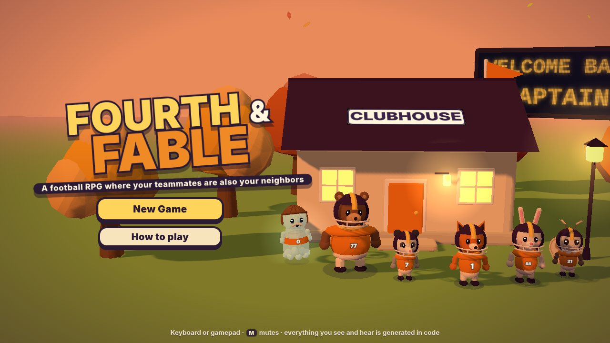
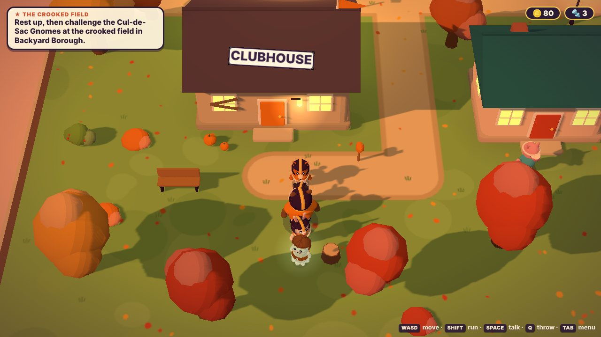
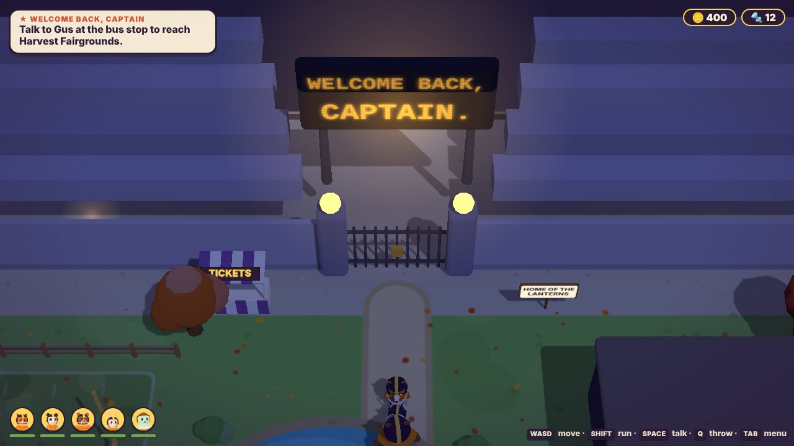
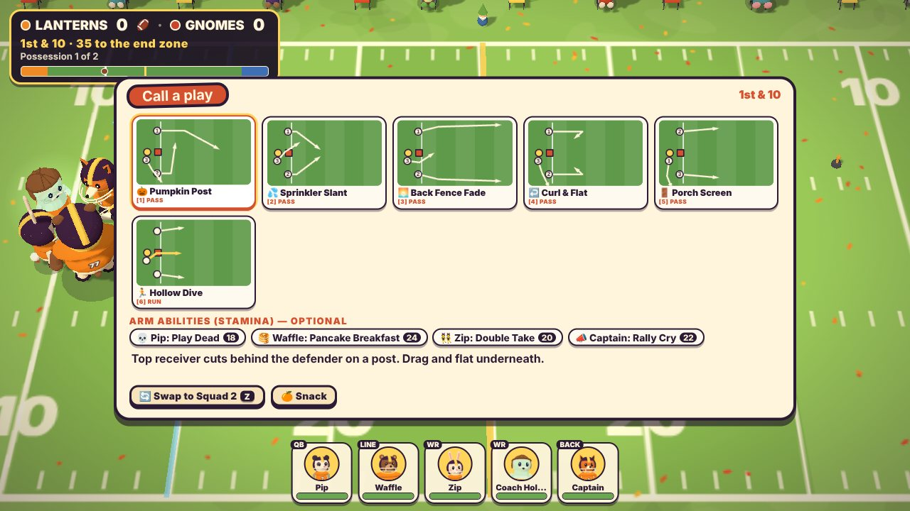
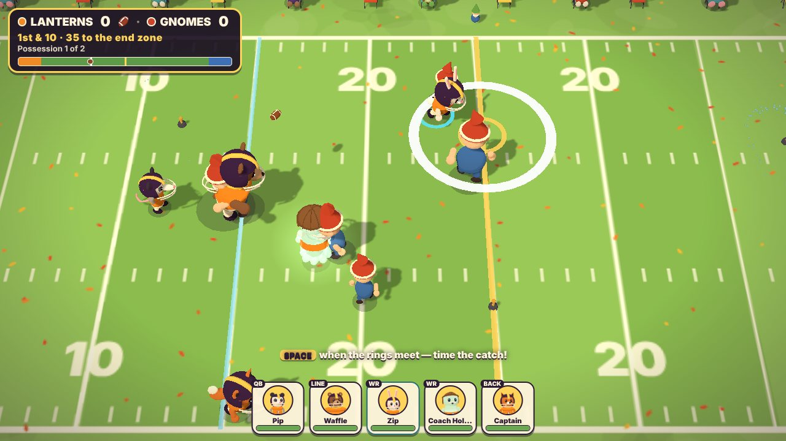
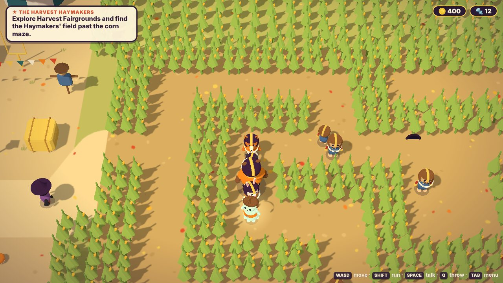
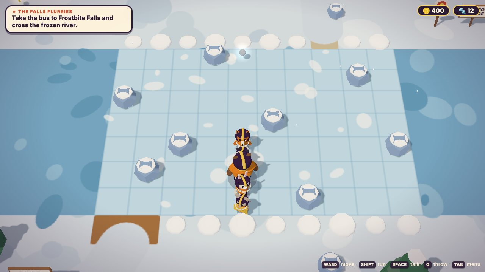
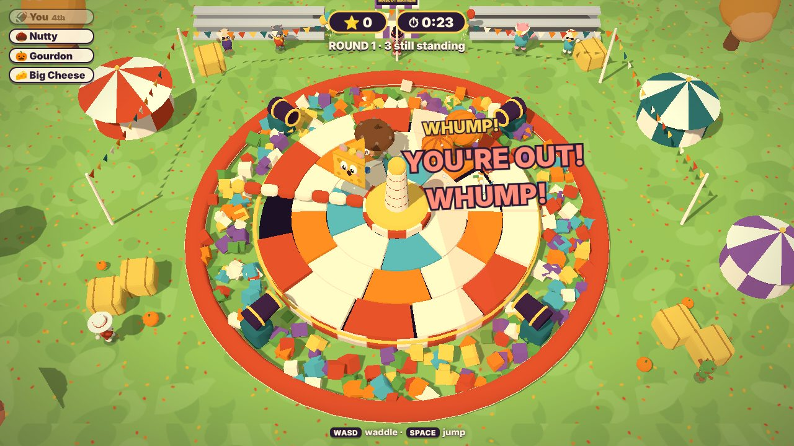
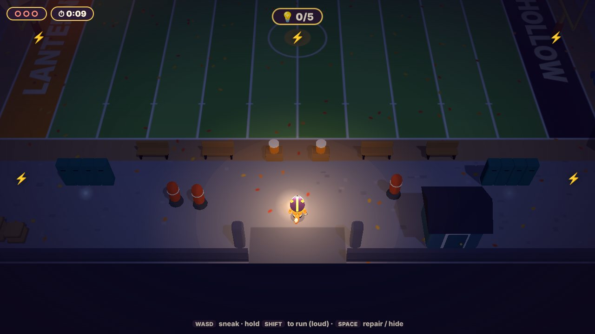

# Fourth & Fable 🏈

*A football RPG where your teammates are also your neighbors.*

You step off the afternoon bus in **Huddle Hollow**, a little town built around an
abandoned football stadium. You've inherited its rundown clubhouse — and, it turns
out, the captaincy of a team that doesn't exist yet: a nervous possum quarterback,
a refrigerator-sized bear who cooks at the diner, a rabbit who cannot stop talking,
a moth who only plays under lights, and a ghost kicker who insists he is still
under contract.

Find five people willing to play. Win a game on a crooked backyard field. And then
figure out why, across town, a dead scoreboard just lit up to say
**WELCOME BACK, CAPTAIN** — when you have never been here before.



Runs in the browser. No install, no build step, no asset files: every model,
texture, sound effect and tune is generated in code.

| | |
| --- | --- |
|  |  |
|  |  |
|  |  |
|  |  |

## Run it

From the repository root:

```bash
python3 serve.py --open=fable/
```

That starts the no-cache static server this repo already ships and opens
`http://localhost:8000/fable/`. On Windows, double-click **`play-fable.bat`**.
Any static server works (ES modules need `http://`, not `file://`).

## How to play

| | Keyboard | Gamepad |
| --- | --- | --- |
| Move / run | **WASD** or arrows / hold **Shift** | left stick / hold **◯** or **R2** |
| Talk, use, confirm | **Space** | **✕** |
| Throw the football (overworld) | **Q** | **□** |
| Menu ("Team Binder") | **Tab** | **Share** |
| Mute | **M** | |

On a phone or tablet, touch controls appear on the first tap (stick on the left,
buttons on the right; tap a receiver's bubble to throw to them).

**Exploring.** Your squad trails behind you. Throw the football at red-and-white
targets to hit switches from a distance — or at an opponent, to stun them. Walk
your lineman up to anything heavy to **shove** it. Holes in fences are for your
**smallest teammate**: you steer them alone on the far side.

**Opponents are visible.** Slip past them, or pick a fight on your terms (beaten
teams stay beaten until you sleep or take the bus):

- touch one from behind, or after bonking it with the ball → **Blindside** (you get
  the ball and your blockers get a head start);
- get caught by one that's chasing you → you start on **defense**.

**A drive.** Small encounters are a single possession; rival matches alternate
possessions and keep score.

1. **Huddle** — pick a play card (the diagram shows every route), arm any
   abilities you want to spend stamina on, swap squads, eat a snack.
2. **Snap** — the count goes *HUT · HUT · HIKE*. Press on **HIKE**. A clean snap
   holds the rush longer.
3. **Read** — bubbles over your receivers show how open they are (green / yellow /
   red). Throw with **1 2 3** (**□ △ ◯**), take the checkdown, or cross the line of
   scrimmage to scramble.
4. **Catch** — press as the two rings meet. Good timing secures it; *perfect*
   timing staggers the nearest defender and gives a burst of speed.
5. **Run** — **Space** jukes, **Shift** spins, **E** laterals to a teammate behind
   you. A red ring means a tackle is about to land: dodge as it closes.

Four downs to reach the gold line. On fourth down you can kick a field goal
(stop the needle in the green) or, in a match, punt.

**On defense** you choose a coverage, time your jump on the snap, and steer the
defender with the blue ring (**E** switches to whoever is nearest the ball).
**Space** is a committed dive tackle. When the ball is in the air, get under it
and press as the rings meet: good timing swats it, perfect timing picks it off —
and then you're the one running.

**Stamina is health.** Tackles, jukes, spins and abilities all spend it. Below
20% a teammate is *exhausted*: slower, and locked out of their signature ability
until they rest on a bench, eat something, or sit out a few plays on the other
squad.

## What's in the game

**Nine teammates**, each with a position, stats that grow as they level, a slot
for gear, a friendship track, and a signature ability:

| | Role | Ability |
| --- | --- | --- |
| The Captain (you — pick a species) | Back | **Rally Cry** — the squad starts the play Hyped and shakes off bad statuses |
| Pip the Possum | Quarterback | **Play Dead** — flops when the rush arrives; rushers wander off confused |
| Waffle the Bear | Lineman | **Pancake Breakfast** — flattens a defender and leaves a syrup patch that slows the other side |
| Zip the Rabbit | Receiver | **Double Take** — a decoy runs the mirrored route and drags coverage with it |
| June the Moth | Safety | **Lights Out** — their passer reads late and throws wild |
| Coach Hollow | Ghost kicker | **Second Chance** — re-kick a miss (stamina is only spent if you use it) |
| Big Cheese | Back | **Stinky Cheese** — defenders can't bear to stand near him |
| Slush the Penguin | Corner | **Belly Slide** — a long untacklable slide after the catch |
| Sal the Seagull | Corner | **Snatch** — the first hit tries to strip the ball |

**Two squads.** One takes the field on offense, the other on defense, and you can
swap them in any huddle. The bench recovers stamina every play.

**Status effects** come from the places you play and the teams you face: Soggy
(sprinklers), Butterfingers, Brain Freeze, Glitched, Spooked, Dizzy (three spins
in one run will do it), Hyped, Sticky.

**Friendships unlock combo plays.** Fix the diner and Pip and Zip will be arguing
in a booth; settle it and they invent the No-Look Pass. Others come from hanging
out with teammates at the clubhouse.

**Four regions, each built around one obstacle** that you learn while exploring,
practise in a minigame, and then have to play through in the rival match:

| Region | Obstacle | Rival |
| --- | --- | --- |
| Backyard Borough | sprinklers | the Cul-de-Sac Gnomes |
| Harvest Fairgrounds | hay bales and a corn maze | the Harvest Haymakers |
| Frostbite Falls | ice — on the river you slide until something stops you | the Falls Flurries |
| Neon Boardwalk | flickering lights; three breakers to find | the Boardwalk Buzzers |

Beat all four, finish restoring the stadium, and come back after sunset.

**Minigames that live in the world** — each with medals, a harder version, and
its own kind of prize:

| | Where | Prize |
| --- | --- | --- |
| **Backyard Blitz** — 2-on-2 football around the sprinklers | the Acorn twins, Borough | trick plays |
| **Snack Shack Rush** — run the stand through the halftime rush | Frostbite Falls, the stadium | coins, diner recipes |
| **Field Goal Golf** — kick through courses with bounces, slopes and wind | Fairgrounds | kicking gear |
| **Mascot Mayhem** — survive the stage in an oversized costume | Fairgrounds | costumes, a recruit |
| **Midnight Maintenance** — fix the stadium lights without Wick noticing | the stadium fuse box, at night | clues, rare parts |

Plus the Lawn Dash against Zip, and fishing off the pond dock (some fish only bite
after dark).

**Huddle Hollow changes because you play**, never because a clock ran out. Pin
coins and spare parts to projects on the notice board:

- **Clubhouse** — lets you decorate it (furniture from the shop, trophies from
  rivals);
- **Diner** — game-day meals that buff the whole team through your next match;
- **Practice field** — the Route Lab (draw up your own pass plays) and free
  practice drives;
- **Arcade** — replay any minigame, try hard modes, claim prizes, and enter the
  Hollow Cup (three random machines back to back);
- **Stadium** — first the gate (exhibition games against teams you've beaten,
  and something to chase after dark), then the lights.

The cot in the clubhouse rests the team and lets you pick the time of day.
Uniform colours and your sideline mascot are in the clubhouse lockers.

## Under the hood

```
fable/
  index.html, styles.css
  src/
    core/      loop + mode stack, input (keys / pad / touch), synth audio, UI, save, particles
    art/       toon materials + geometry kit, character builder, props, mascots, portraits
    world/     the overworld: collision, party, interactions, roaming opponents, field abilities
    areas/     one module per map (ground painting + props + NPCs + puzzles)
    battle/    the drive simulation, venues, HUD
    minigames/ shared shell (intro → countdown → results → rewards) and the games
    game/      title, story scripts, town systems, menus, cutscenes
    data/      cast, opponent teams, plays, items, quests
```

- **Characters** are one small rig dressed in code (animals, a ghost, gnomes,
  scarecrows, snowmen, robots, a clockwork lantern) and animated by blending
  poses — no keyframe data.
- **Maps** are declared in a few dozen lines each: paint the ground on a canvas,
  place props, and the static geometry is baked into a couple of draw calls.
- **Battles** are simulated in "drive space" (the offense always attacks +x) and
  rotated for display, so one set of AI serves both sides of the ball.
- **Music** is a tiny step sequencer; sound effects are oscillators and filtered
  noise.
- The save is one JSON blob in `localStorage`.

## Dev

`tools/fable-qa.cjs` drives the game in headless Chromium. With `?test` the page
hands frame stepping to the harness, so runs are deterministic and quick even on
software GL. Screenshots land in `qa/` (git-ignored).

```bash
node tools/fable-qa.cjs --q "area=borough&preset=team" --steps 30 --shot borough.png
node tools/fable-qa.cjs --script tools/fable-scenarios/chapter1.cjs     # opening → first match → scoreboard → bus
node tools/fable-qa.cjs --script tools/fable-scenarios/chapters.cjs     # regions 2–4 and the finale (battles skipped)
node tools/fable-qa.cjs --script tools/fable-scenarios/puzzles.cjs      # ice river, corn maze, breakers — with real stick input
node tools/fable-qa.cjs --script tools/fable-scenarios/battle.cjs --team gnomes --kind match --n 5 --log   # built-in autopilot
node tools/fable-qa.cjs --script tools/fable-scenarios/battle-manual.cjs --team gnomes --n 5 --skill 0.5   # a bot pressing the real buttons
bash tools/fable-scenarios/run-all.sh                                   # everything, with a pass/fail table
node tools/fable-qa.cjs --script tools/fable-scenarios/realtime.cjs     # un-stepped: title → new game → walking
node tools/fable-qa.cjs --script tools/fable-scenarios/docs.cjs         # regenerate docs/*.jpg
```

**How hard is it?** `battle-manual.cjs` plays whole matches through the same
virtual buttons a player presses, with one human-like timing error per snap,
catch and tackle. With the party at roughly the level the story leaves it — and
no items, no meals, random play calls — it wins:

| Rival | decent timing (skill 0.7) | sloppy timing (skill 0.45) |
| --- | --- | --- |
| Cul-de-Sac Gnomes | 8 of 8 | 6 of 8 |
| Harvest Haymakers | 8 of 8 | 5 of 8 |
| Falls Flurries | 7 of 8 | 2 of 8 |
| Boardwalk Buzzers | 8 of 8 | 3 of 8 |
| The Graveyard Shift | 8 of 8 | 5 of 10 |

Small samples — read them as "nearly always" and "about half", not as rates.
The shape is deliberate: forgiving at the start, and from Frostbite Falls on a
sloppy player needs to improve, level up, or eat before the game. (The Graveyard
Shift's "8 of 8" was measured one notch either side of the shipped setting.)

Handy URL parameters: `?area=<id>&preset=<start|team|ch2|fair|frost|neon|all>`
jumps into the world at that point in the story, `?battle=<team>&kind=match`
starts a game, `?mg=<id>` launches a minigame, `?gallery=team|foes|town|anim`
lines up the character models. (`playwright` needs to be resolvable by Node for
the QA tool.)

## Not here (yet)

Things the pitch gestures at that this build does not do: more than one save
slot, rebinding controls, a second layer of stadium upgrades beyond the two
shown (vendors and new residents are described rather than simulated), online
anything. Balance was tuned against a button-pressing bot (table above), not a
room full of playtesters, and the sound has only ever been heard by a headless
browser — the difficulty curve and the music mix are the two things most likely
to want a human ear.
