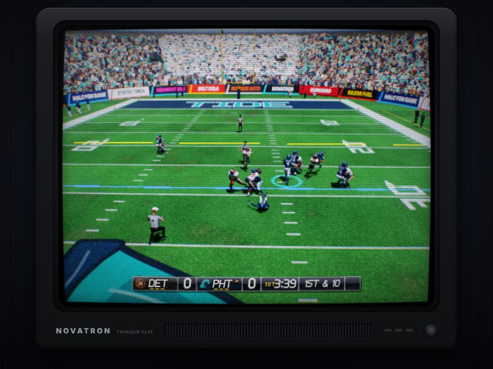
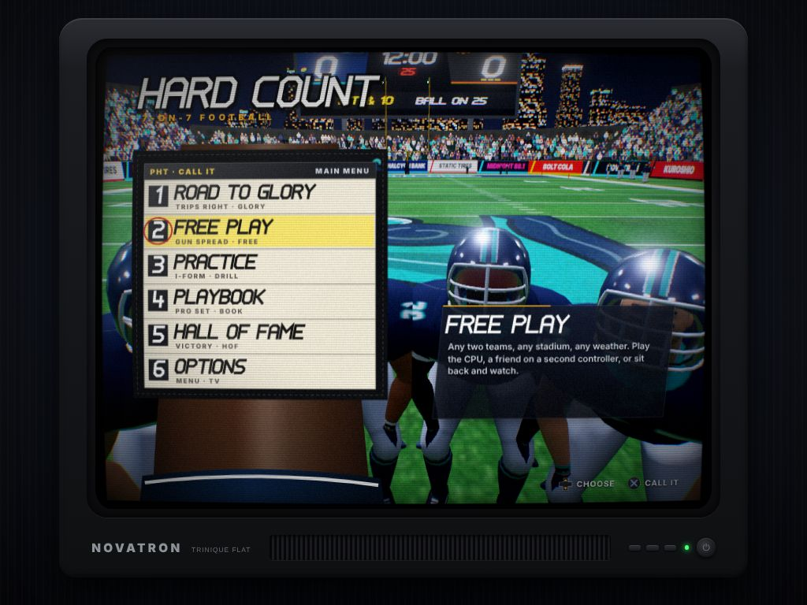
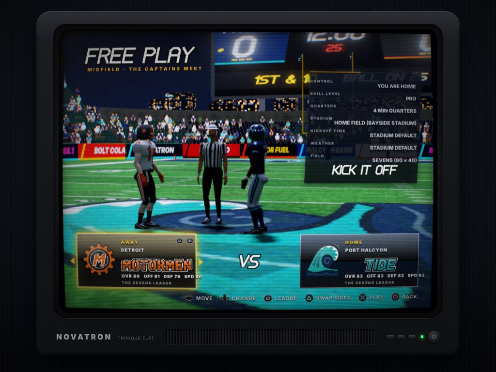
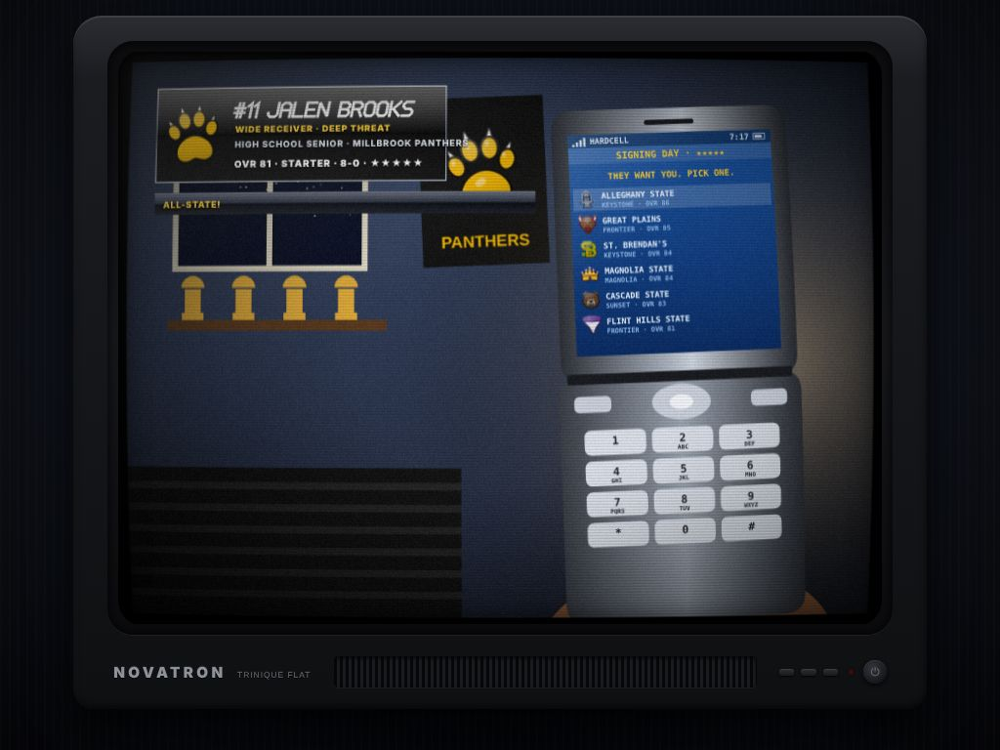
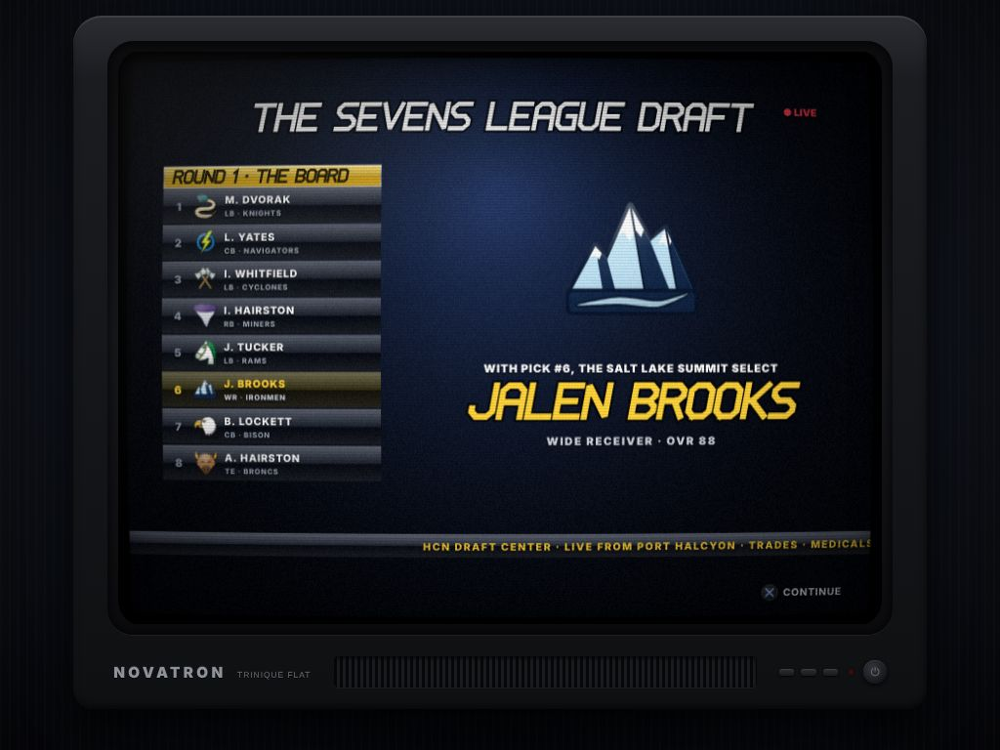
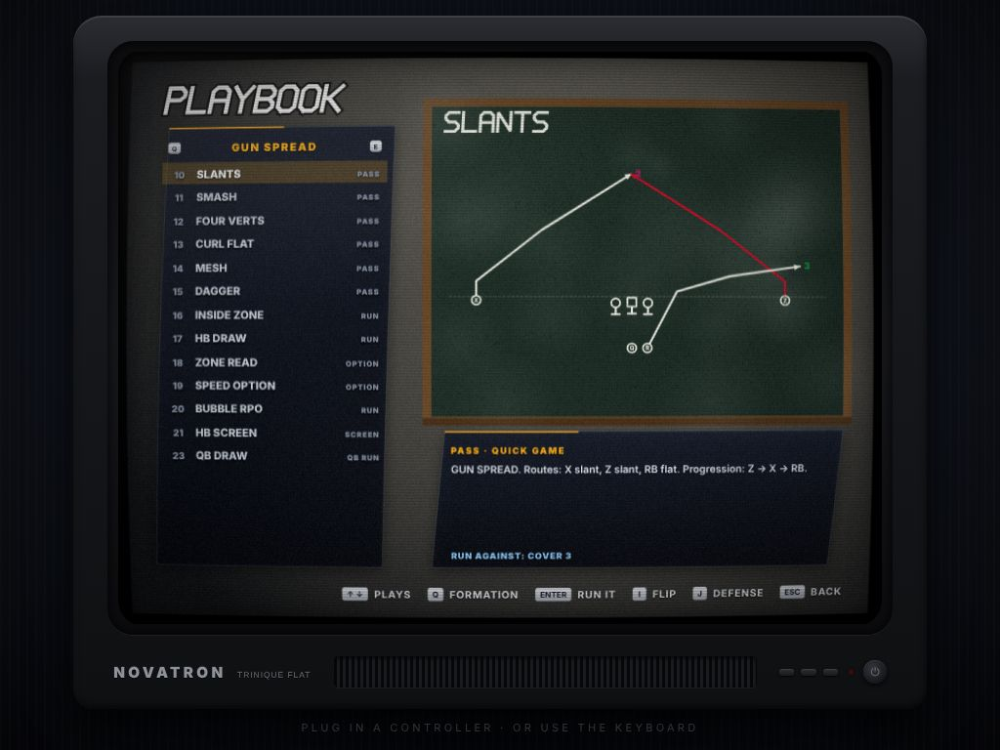
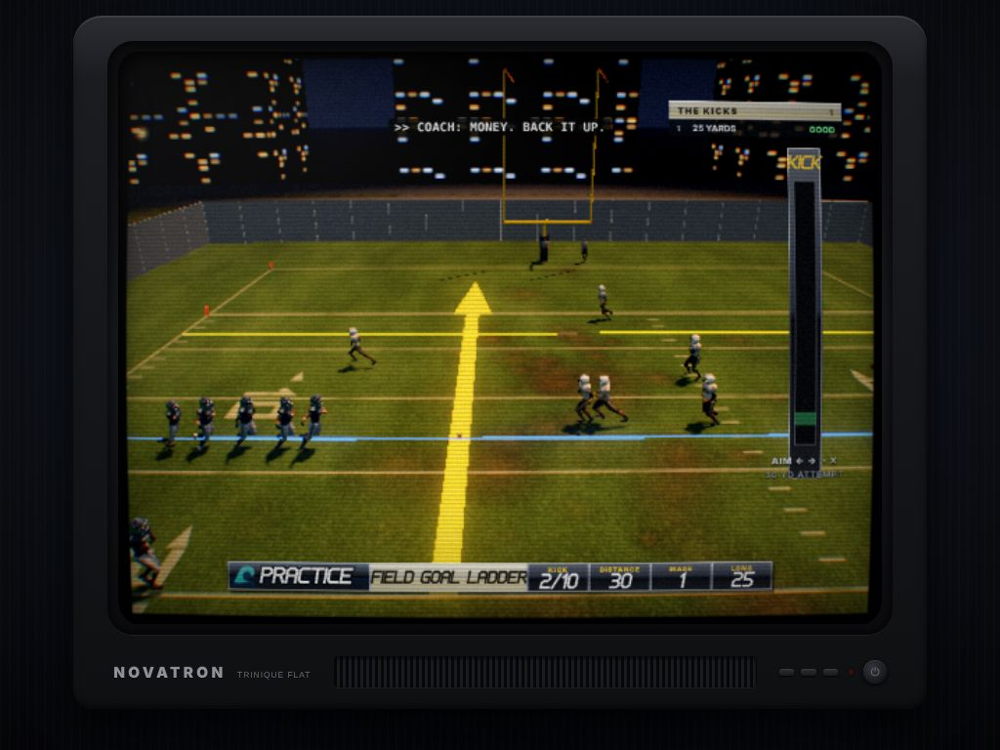
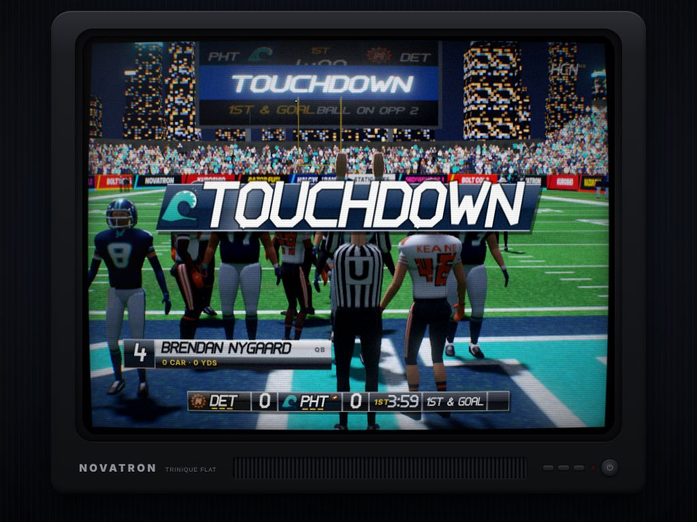

# HARD COUNT

*Seven a side. Full pads. Every lateral on the table.*

A 7-on-7 tackle football game that looks and plays like a 2005 console game,
shown on the same NOVATRON TRINIQUE FLAT CRT as MIDNIGHT FREQUENCY: curved
glass, scanlines, bloom on the stadium lights, channel-change static between
screens. Everything is generated in code: the players, the seven stadiums, the
crowd, the band, the play art, the music. No art or audio files, no build step.
It plays with a PS5 DualSense (any standard controller works, and so does the
keyboard).



## Run it

**Windows:** double-click **`hardcount.bat`** in the repository root. It starts a
little local server (Python if you have it, PowerShell if you don't) and opens
the game in your browser. Keep the window open while you play.

**Mac / Linux:**

```bash
python3 serve.py --open hardcount/
```

Any static server works (`http://localhost:8000/hardcount/`); ES modules need
http://, not file://. Plug in the DualSense over USB or Bluetooth and press any
button: the TV says **DUALSENSE CONNECTED**, the button prompts switch to
PlayStation glyphs, and the controller rumbles on contact. A second controller
is player 2.

## Modes

The main menu is a huddle: you're the quarterback, and the modes are the plays
on your wristband.

| | |
| --- | --- |
|  |  |

- **Road to Glory.** Build a player (quarterback, running back, receiver, tight
  end, linebacker, corner or safety; an archetype; name, number, skin, hair; your
  high school) under the lights on a Friday night, then live a career off a flip
  phone: a senior season in high school, signing day with the offers your stars
  earned, up to four years of college (declare after three), the Sevens League
  draft on TV, a pro career, and retirement into the Hall of Fame. Texts from
  coaches and your mom, headlines, standings, a schedule, and XP to spend on
  training. In games you only control your own man: when you're not on the
  field the broadcast fast-forwards like a VCR.
- **Free Play.** The captains meet the referee at midfield. Any two of 16 pro
  teams, 24 colleges or 12 high schools, seven stadiums (a Friday-night high
  school field, a college bowl, a waterfront pro stadium, a dome, an
  industrial bowl, a snowy horseshoe, a city park), time of day, weather,
  quarter length and skill level. One player against the CPU, two players head
  to head, or watch the CPU play itself.
- **Practice.** Offense reps and defense reps from the 25 that reset every snap,
  the two-minute drill (down four, 2:00, three timeouts), a ten-kick field goal
  ladder, and kick returns. A coach comments on every rep and the clipboard
  keeps your best sessions.
- **Playbook.** Every play drawn on a chalkboard, and run live against any
  defense with the trails left on the slate.
- **Hall of Fame.** The record book (single-game records with names and dates),
  the trophy case from Road to Glory, and the plaques of the players you retired.
- **Options.** The TV's own blue on-screen menu: picture (CRT effect, internal
  resolution, auto quality), sound (music, effects, crowd, captions, the PA
  announcer), gameplay (skill level, quarter length, accelerated clock, field
  size, penalties, fatigue, camera, pass lead, auto switch) and vibration.

| | |
| --- | --- |
|  |  |
|  |  |

## The football

- **The field.** Sevens: 80 yards goal line to goal line, 40 wide, 10-yard end
  zones, hash marks 10 yards apart (a full 100 × 53⅓ field is an option).
  Offense: quarterback, center, two guards and three skill players. Defense:
  two linemen, two linebackers, two corners and a safety.
- **The rules.** Four downs to make ten. Touchdowns, extra points (or go for
  two), field goals, safeties, punts, kickoffs and touchbacks, a 25-second play
  clock, three timeouts a half, the two-minute warning, overtime. Penalties
  with a flag on the field and your call to accept or decline: offside (a
  lineman jumping at your hard count, or your own man lined up over the ball),
  delay of game, holding, pass interference, illegal forward pass, intentional
  grounding, roughing the passer, face mask.
- **The playbook.** 56 offensive plays in 12 formations (gun spread, trips,
  bunch, empty, pistol, I-form, singleback, flexbone, wishbone, wildcat, goal
  line) and 16 defenses (cover 0 to quarters, Tampa 2, spy, fire zone and the
  blitzes, bear front, goal line, prevent).
- **Laterals and trick plays.** Any player can pitch it backward at any time (L1)
  and a lateral on the ground is a live ball. Hook and ladder, flea flicker,
  double pass, halfback pass, statue of liberty, reverse, Philly special, rugby
  sweep, and the option game: zone read, speed option, inverted veer, midline,
  triple option, wishbone pitch. Kick returns have a reverse and a throwback.
- **The game.** Every player is simulated with ratings (speed, strength, hands,
  route running, coverage, block shedding and more): routes and reads, man and
  zone coverage, pass rush against pass protection, pursuit angles, broken
  tackles, gang tackles, fumbles, tipped passes, fatigue. CPU coordinators call
  plays by down, distance, score and clock.
- **The broadcast.** Score bug, yellow first-down line, network bug, closed
  captions from the booth, a PA announcer, a crowd that reacts to what happens
  (and to whose fans they are), a band, officials with flags and signals, a
  coin toss, halftime and final box scores, instant replay with free camera
  and a telestrator, and the stadium scoreboards keeping score.



## Controls

| Situation | DualSense | Keyboard |
| --- | --- | --- |
| Menus | D-pad or stick, ✕ select, ◯ back, L1 / R1 tabs | arrows or WASD, Enter, Esc, Q / E |
| Play call | stick moves across the wristband, L1 / R1 formations, ✕ call, △ flip, □ coach's pick | arrows, Q / E, K, I, J |
| Before the snap (offense) | ✕ snap, □ hard count, △ audible, R1 hot route, L1 motion | K, J, I, E, Q |
| Quarterback | ✕ ◯ □ △ throw to that receiver (tap for touch, hold for a bullet), L2 + stick to lead the throw, L1 pump fake, R3 throw it away | K L J I, Z, Q, V |
| Ball carrier | stick runs, R2 sprints, L1 lateral, □ stiff arm, ◯ spin, △ hurdle, ✕ dive, R1 protect the ball, right stick juke / truck / spin | WASD, Shift, Q, J, L, I, K, E, arrows |
| Defense | ◯ switch player, ✕ dive tackle, □ strip, △ jump / swat, right stick ↑ hit stick, ↓ cut tackle, R2 sprint | L, K, J, I, arrows, Shift |
| Kicking | stick aims, then ✕ to start the swing, ✕ for power, ✕ for accuracy | A / D, K |
| Anytime | OPTIONS pause, touchpad timeout, CREATE instant replay | Esc, T, R |

On run plays the handoff is automatic and you take the ball carrier; on the
option the quarterback rides the mesh and makes the read himself until you
grab the stick (✕ give, △ keep, L1 pitch).

## Under the hood

- `src/sim/` is a headless football simulation (no three.js): a fixed 60 Hz
  step, players as bodies with ratings, a rules engine, and the play AI. It
  runs in Node for the tools below.
- `src/gfx/` builds the players (skinned, kitted per team, animated from the
  sim's action contract), the stadiums (field paint, stands, lights, crowds,
  scoreboards, weather), the logos and the play art.
- `src/match/` is the broadcast: cameras, the HUD, the wristband, controls,
  the booth, officials, replays, sound and the practice drills.
- `src/audio/` synthesizes everything with WebAudio: hits, whistles, the QB's
  cadence, the crowd (formant-synthesized voices), the band and the music.
- See `DESIGN.md` for the module contracts.

Quality steps itself down (internal 3D resolution, multisampling) if the frame
rate sinks, and back up when there's headroom.

### Tools

```bash
node hardcount/tools/simgame.mjs 8          # play 8 CPU-vs-CPU games headless, print box scores and averages
node hardcount/tools/playbench.mjs run 300  # run a kind of play many times and tally the outcomes (--off id --def id)
node hardcount/tools/drive.mjs "screen=practice" script.json   # drive the real game in Chromium
```

`drive.mjs` steps are `{ key }`, `{ wait }`, `{ until: 'js', timeout }`,
`{ eval: 'js' }`, `{ shot: 'name.png' }`, and with `{ dualsense: true }` first,
a virtual DualSense: `{ pad: 'cross' }`, `{ stick: [lx, ly, rx, ry], hold }`
(rumble requests are collected in `window.__rumbles`). URL shortcuts:
`?screen=match&home=pht&away=det&qa=play` (straight to a first and ten),
`qa=kick&kicking=home`, `screen=practice`, `screen=playbook`, `screen=gallery`
(every animation), `screen=venueview` (the stadiums).
